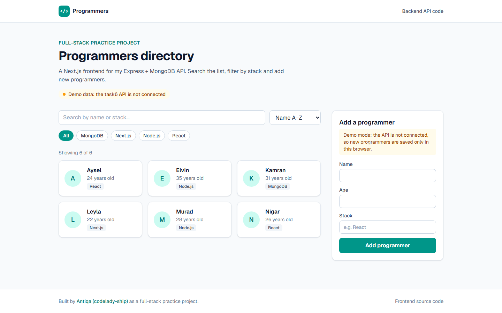

# Programmers directory (Next.js frontend)

[](https://task7-front-end-for-task6.vercel.app/)

> AZ: Express + MongoDB API-si (task6) üçün Next.js frontend: axtarış, stack üzrə filtr və yeni proqramçı əlavə etmə.

A Next.js frontend for my [task6 Express + MongoDB API](https://github.com/codelady-ship/task6.mongodb).
It lists programmers, lets you search and filter them by stack, and add new ones.



## How it gets data

- The page is a Server Component. It reads the list from `PROGRAMMERS_API_URL` on every request.
- If `PROGRAMMERS_API_URL` is not set, or the API does not answer within 10 seconds, it shows built-in sample data
  and a "demo data" badge.
- **Add a programmer**
  - With an API: the form calls a Server Action that `POST`s to the API, then refreshes the list. The API URL stays on the server.
  - Without an API (demo mode): new programmers are saved only in this browser (localStorage), and the form says so.

## Features

- Search by name or stack, filter chips per stack, sort by name or age.
- Add form with validation (name, age 14–99, stack with suggestions).
- Responsive layout, accessible labels, live/demo status badge.
- SEO: title, description, canonical URL, Open Graph image, favicon, `robots.txt`, `sitemap.xml`.

## Tech stack

Next.js 15 (App Router, Server Actions) · React 19 · TypeScript · Tailwind CSS 4 · backend: Express 5 + Mongoose 8 + MongoDB Atlas

## Run locally

```bash
git clone https://github.com/codelady-ship/task7-front-end-for-task6-.git
cd task7-front-end-for-task6-
npm install
npm run dev     # http://localhost:3000, demo mode
```

To use a real API, create `.env.local` (see `.env.example`):

```bash
PROGRAMMERS_API_URL=http://localhost:8080/programmers
```

## Deployment

Deployed on Vercel from the `main` branch (`next build`). To switch from demo data to the real database, set
`PROGRAMMERS_API_URL` in Vercel (Project > Settings > Environment Variables) to the deployed task6 URL ending in
`/programmers`, then redeploy. See the [task6 README](https://github.com/codelady-ship/task6.mongodb#deploy-on-render).

## What I learned

- Fetching data in a Server Component and falling back gracefully when an API is down.
- Using a Server Action to call a backend without exposing its URL to the browser.
- Keeping client-side search, filter and sort in a small client component.
- Adding SEO metadata, a generated Open Graph image, `robots.txt` and `sitemap.xml` with the App Router.
